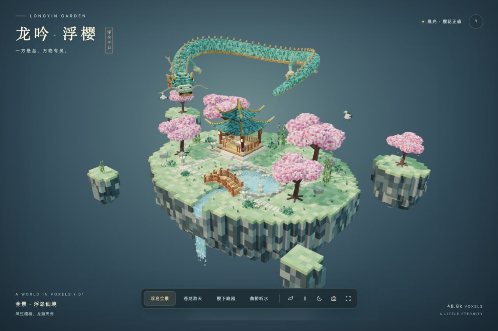
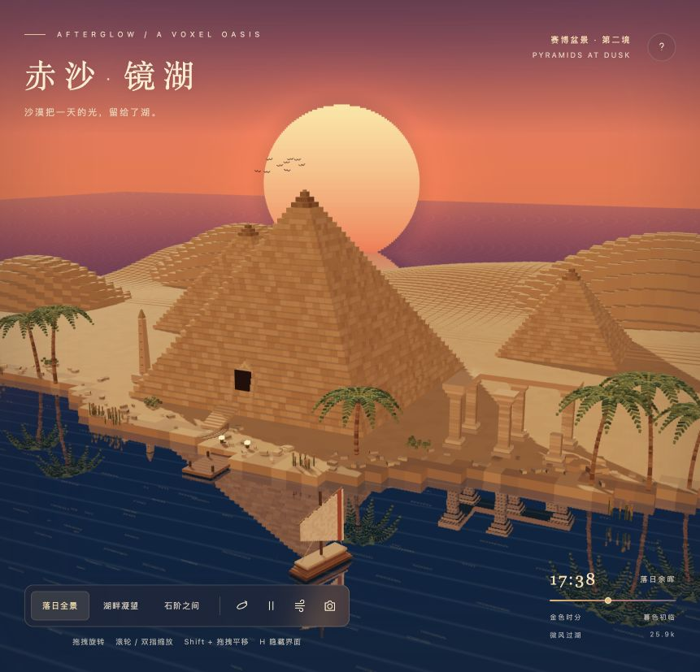
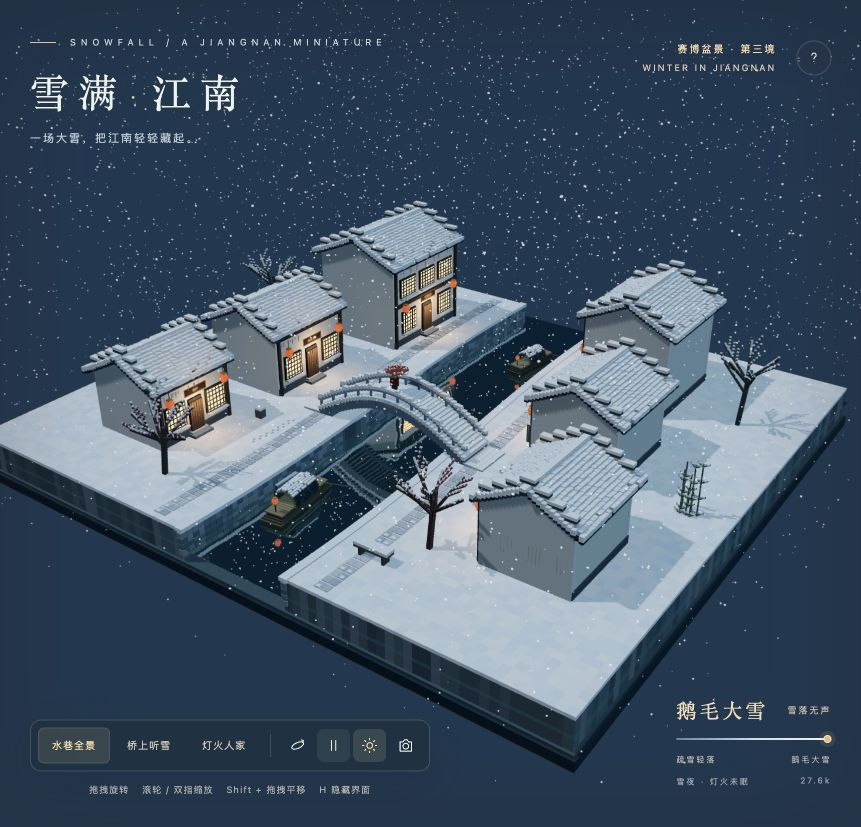

# 赛博盆景 · Cyber Bonsai

三幅可以旋转、漫游、留图的体素风景。把一方小世界，放在浏览器里。

[在线进入赛博盆景](https://landowang.github.io/cyber-bonsai/) · [查看统一画廊效果图](docs/gallery.jpg)

| 龙吟浮樱 | 赤沙镜湖 | 雪满江南 |
| --- | --- | --- |
| [](https://landowang.github.io/cyber-bonsai/scenes/longyin-garden/) | [](https://landowang.github.io/cyber-bonsai/scenes/sunset-pyramids/) | [](https://landowang.github.io/cyber-bonsai/scenes/snowy-jiangnan/) |
| 苍龙、樱花浮岛、双檐凉亭与流水 | 金字塔、落日、湖面倒影与帆船 | 粉墙黛瓦、石拱桥、乌篷船与漫天飞雪 |

## 打开盆景

克隆仓库后，用现代桌面浏览器打开根目录的 **`index.html`**，从画廊进入场景。需要启用 WebGL；所有场景和字体回退均不依赖外部网络。

```sh
git clone https://github.com/LandoWang/cyber-bonsai.git
cd cyber-bonsai
python3 -m http.server 8080 --bind 127.0.0.1
```

然后打开 <http://127.0.0.1:8080>。在 macOS 上也可以运行 `open index.html`；若嵌入式预览器限制本地文件协议，使用上面的本地服务器。

每个 `scenes/<场景>/index.html` 都是独立成品，内置渲染库、场景代码和样式。复制这一个 HTML 文件即可保存或离线使用。也可以直接访问上面的在线画廊，无需下载。

## 在线发布

网站由 GitHub Pages 托管，地址为 <https://landowang.github.io/cyber-bonsai/>。Pages 使用 `main` 分支的根目录，`.nojekyll` 让已构建的 HTML 和资源直接发布。将更新后的源文件和构建成品推送到 `main` 后，GitHub 会自动更新网站。

## 观景方式

| 操作 | 功能 |
| --- | --- |
| 拖拽 | 旋转视角 |
| 滚轮 / 双指 | 缩放 |
| Shift + 拖拽 | 平移 |
| 视角按钮 | 平滑切换预设镜头 |
| 自动环游 | 围绕场景旋转 |
| 空格 | 暂停 / 继续动画（页面获得焦点时） |
| `R` | 回到全景 |
| `H` | 显示 / 隐藏界面 |
| 相机按钮 | 生成 PNG 预览并下载 |

- **龙吟浮樱**：四个视角、晨光 / 月夜、飘落樱花、锦鲤、瀑布、仙鹤与缓缓游动的巨龙。
- **赤沙镜湖**：三个视角、夕阳滑杆、静水 / 微风、实时倒影、帆船与飞鸟。画面时刻是艺术化的光线控制，并非天文模拟。
- **雪满江南**：三个视角、雪势滑杆、薄暮 / 雪夜、屋顶积雪、红伞行人、灯火与实时水面倒影。

## 编辑与构建

构建仅需 **Python 3.9+**，不需要 npm 安装、打包器或网络。源码和依赖分开保存，构建时合并成独立 HTML。

```sh
# 重新构建全部场景
python3 scripts/build.py

# 只构建一个场景
python3 scripts/build.py --scene snowy-jiangnan

# 检查已提交的成品是否与源码一致，不修改文件
python3 scripts/build.py --check

# 完整检查；另外需要 Node.js 22+ 做 JavaScript 语法检查
python3 scripts/check.py
```

编辑 `scenes/<场景>/scene.js` 修改三维内容，编辑 `shell.html` 修改界面。请将源文件和重新生成的 `index.html` 一起提交。直接改成品 HTML 会在下次构建时被覆盖。

GitHub Actions 检查构建是否可复现、画廊链接与资源路径、独立页面是否包含外部资源，以及最终内联 JavaScript 的语法。视觉效果和 WebGL 性能仍需在浏览器中检查。

## 仓库结构

```text
index.html                    # 三幅盆景的统一画廊
scenes/
  longyin-garden/              # 龙吟浮樱
  sunset-pyramids/             # 赤沙镜湖
  snowy-jiangnan/              # 雪满江南
    scene.js                  # 场景、动画和交互
    shell.html                # 页面与界面模板
    index.html                # 可直接打开的独立成品
    preview.jpg               # 实际浏览器效果图
vendor/                       # 三个场景共用的固定版本依赖
scripts/                      # 构建与校验
.github/workflows/check.yml   # 自动检查
```

## 第三方依赖

使用 Three.js **0.160.1** 和同版本的 `Reflector`，依赖已随仓库保存。版权和 MIT 许可见 [第三方说明](THIRD_PARTY_NOTICES.md)；完整许可也会嵌入生成的场景 HTML。
